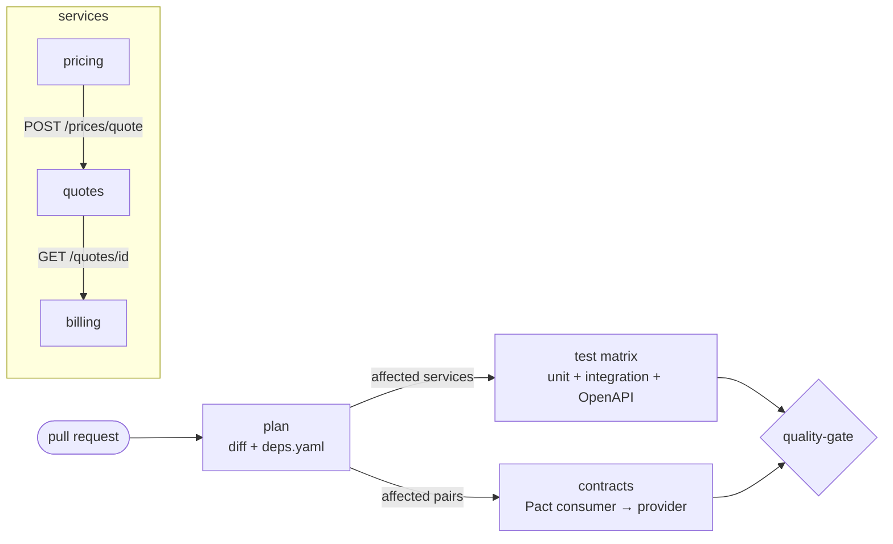

# pr-quality-gate

**Risk-aware CI for Python microservices: every PR runs only the tests its change can affect, and a breaking API change between services is blocked before merge.**

Two problems show up as a service estate grows:

1. **Full test runs on every PR get slow.** Engineers wait for suites that can't possibly be affected by their change, then start skipping or re-running them.
2. **Breaking changes leak between services.** A provider renames a field, updates its own spec and tests, everything is green, and a consumer breaks in production.

This repo is a small reference implementation of a quality gate for both, on three Lambda-style services in an energy-pricing domain.



## How it works

**1. Dependency model → test selection** ([`quality/deps.yaml`](quality/deps.yaml), [`quality/select_tests.py`](quality/select_tests.py))

The `plan` job diffs the PR against its merge base and maps each changed file to a service:

| Change | What runs |
|---|---|
| service `X` code, tests or `openapi.yaml` | `X`'s suite + its direct consumers' suites + every pact `X` is part of |
| shared code (`libs/`, `quality/`, CI config, dependencies) | everything |
| docs only (`*.md`, `docs/`) | nothing |
| a path the model doesn't know | everything (**fails safe, never fails open**) |

The selector decides what *not* to test, so it has its own tests ([`quality/tests`](quality/tests)) and they run on every PR before it's trusted. The decision and its reasons go into the job summary.

**2. Two layers of API checks**

- **OpenAPI self-check** (in each service's integration tests, [`libs/testkit/openapi.py`](libs/testkit/openapi.py)): does the handler return what its own spec documents?
- **Consumer-driven contracts with Pact** ([`quality/run_contracts.py`](quality/run_contracts.py)): does the provider still return what its consumers *actually use*? Consumers declare only the fields they read (billing reads 5 fields of a quote, not 7), so providers stay free to change everything else.

The second layer catches what the first can't: in `demo/breaking-contract`, pricing renames a field **and updates its own spec and tests**, so the OpenAPI check passes. Only the pact from `quotes` fails.

Provider verification replays pacts against the **real Lambda handler** over HTTP via a tiny local adapter ([`libs/lambda_http`](libs/lambda_http)), with provider states seeded directly into the service's store.

**3. One required check**

The `quality-gate` job aggregates results: jobs the plan skipped count as passed, failed or cancelled ones don't. Branch protection needs exactly one required status check, however the matrix changes.

## Demo PRs

| Branch | Change | What the gate does |
|---|---|---|
| `demo/low-risk` | wording in billing | tests **billing** only, plus billing's pact with quotes; pricing and quotes are skipped → ✅ |
| `demo/breaking-contract` | pricing renames `unit_rate` → `unit_rate_pence` and updates its own spec + tests | pricing and quotes suites ✅, **Pact verification ❌**: `Actual map is missing the following keys: unit_rate` → merge blocked |
| `demo/pricing-formula` | volume-discount boundary `>=` → `>` | everything ✅. **The tests can't see this bug.** See [Next](#next) |

## Run locally

Python 3.12+.

```bash
python -m venv .venv
# Windows: .venv\Scripts\activate      macOS/Linux: source .venv/bin/activate
pip install -r requirements-dev.txt

pytest                                            # unit + integration (contract tests are opt-in)
python quality/run_contracts.py                   # Pact: consumers → pacts/*.json → providers verify
python quality/select_tests.py --base main --markdown   # what a PR from this branch would run
```

## Layout

```
services/<name>/src/        Lambda-style handler + domain code
services/<name>/openapi.yaml
services/<name>/tests/      unit/ integration/ contract/
libs/lambda_http/           router + localhost adapter for handlers
libs/testkit/               OpenAPI response check, Pact conventions
quality/                    deps.yaml, test selector, contract runner (+ tests)
.github/workflows/          quality-gate.yml
demo/patches/               the three demo changes (scripts/bootstrap.py turns them into branches)
```

## Design decisions and trade-offs

- **Direct consumers only, not the transitive closure.** A pricing change re-tests quotes but not billing, because billing is protected by its own pact with quotes. Transitive selection is safer but erodes the speed win as the graph grows; contracts are what make the narrower blast radius safe.
- **File-based pacts, no broker.** Consumer and provider live in one repo and are verified in one job. With separate repos, the same tests would publish to a Pact Broker and gate deploys with `can-i-deploy`.
- **A static dependency map, not one inferred from imports.** Services talk over HTTP, so import analysis can't see the real edges. The map lives next to the code and is reviewed like code. Unknown paths trigger a full run, so a stale map costs time, not safety.

## Next

- **LLM change-risk classification:** post a risk level and reasons on the PR from the diff and the dependency plan; high risk escalates to a full run plus mutation testing.
- **Targeted mutation testing** (mutmut on changed modules only): on `demo/pricing-formula` a surviving boundary mutant points at the missing test for exactly 100,000 kWh.
- **Automated canary verdicts:** promote or roll back on error-rate and latency SLOs instead of manual sign-off.
